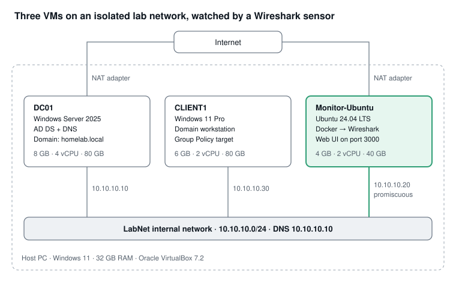

# Home Lab: Active Directory Domain + Network Traffic Monitoring

A three-VM enterprise lab I built on VirtualBox to practice the work of an IT support / systems administrator: running a Windows Server 2025 domain controller, joining a Windows 11 workstation to the domain, managing users and Group Policy, and watching the network traffic behind it all with Wireshark running in Docker.

## What this lab demonstrates

| Skill area | What I did |
| --- | --- |
| **Windows Server & Active Directory** | Installed Windows Server 2025, promoted it to the first domain controller of a new forest (`homelab.local`), with integrated DNS |
| **Networking** | Designed an isolated lab network (`10.10.10.0/24`), with static IP addressing, DNS pointed at the DC, and a separate NAT path to the internet |
| **Client management** | Built a Windows 11 Pro workstation and joined it to the domain |
| **Group Policy & RBAC** | Organizational units, role-based security groups and GPOs scoped by OU and security filtering *(in progress)* |
| **Linux & Docker** | Ubuntu 24.04 host running Wireshark in a container with host networking and raw-capture capabilities |
| **Security monitoring** | A promiscuous-mode sensor that captures DNS, Kerberos, LDAP and SMB traffic between domain machines |
| **PowerShell & Bash** | Server, client and Linux configuration scripted; see [`scripts/`](scripts) |
| **Troubleshooting** | Real problems hit and fixed along the way; see the [Lab Journal](docs/lab-journal.md) |

## Lab at a glance

| VM | OS | Role | LabNet IP | Resources |
| --- | --- | --- | --- | --- |
| **DC01** | Windows Server 2025 Standard (Desktop Experience) | Domain controller, DNS | 10.10.10.10 | 8 GB RAM, 4 vCPU, 80 GB |
| **Monitor-Ubuntu** | Ubuntu 24.04 LTS | Docker host, Wireshark sensor | 10.10.10.20 | 4 GB RAM, 2 vCPU, 40 GB |
| **CLIENT1** | Windows 11 Pro | Domain workstation | 10.10.10.30 | 6 GB RAM, 2 vCPU, 80 GB |

**Host:** Windows 11 PC, 32 GB RAM, Oracle VirtualBox 7.2
**Domain:** `homelab.local` (NetBIOS `HOMELAB`), Windows2025Domain functional level

## Documentation

- **[Build Guide](docs/build-guide.md):** every VM setting, install step and command, with explanations
- **[Lab Journal](docs/lab-journal.md):** dated log of what I built, what broke, and how I fixed it
- **[Wireshark Guide](docs/wireshark-guide.md):** how to read captures from the lab and which filters to use
- **[Design Decisions](docs/design-decisions.md):** why the lab is built the way it is

## Scripts

| Script | Runs on | Purpose |
| --- | --- | --- |
| [`dc01-setup.ps1`](scripts/dc01-setup.ps1) | DC01 | Static IP, AD DS role, rename, new forest |
| [`client-join.ps1`](scripts/client-join.ps1) | Windows 11 client | Static IP, DNS → DC, domain join |
| [`monitor-setup.sh`](scripts/monitor-setup.sh) | Ubuntu | LabNet IP, Docker, Wireshark container |
| [`New-LabUsers.ps1`](scripts/New-LabUsers.ps1) + [`users.csv`](scripts/users.csv) | DC01 | Bulk-create OUs, users and role groups from a CSV |

## Verified results

| Check | Result |
| --- | --- |
| `Get-ADDomain` on DC01 | Forest `homelab.local`, PDC emulator `dc01.homelab.local` |
| Ubuntu → DC01 ping over LabNet | 3/3 replies, under 1 ms |
| Wireshark (browser UI, port 3000) | v4.6.0 running, capturing on the LabNet interface |
| Client DNS: `Resolve-DnsName homelab.local` | Resolves to 10.10.10.10 |

## Roadmap

- [x] Domain controller and DNS
- [x] Isolated lab network and monitoring sensor
- [x] Windows 11 workstation on LabNet
- [ ] Domain join, OUs, role groups and first GPOs
- [ ] Capture and explain a full domain logon (DNS → Kerberos → LDAP → SMB/SYSVOL)
- [ ] File server with department share permissions
- [ ] SIEM (Wazuh) collecting DC security logs, with alerts for lockouts and new admins
- [ ] Attack-and-detect exercise in an isolated subnet (Nmap scan, password spray) traced in Wireshark and the event logs

---

*Built and documented by Santos Lazos ([portfolio](https://lazosalex55.github.io) · [LinkedIn](https://www.linkedin.com/in/santos-lazos-903808247/)). This is a lab for learning; all credentials used in the lab are local to it and are never committed here.*
